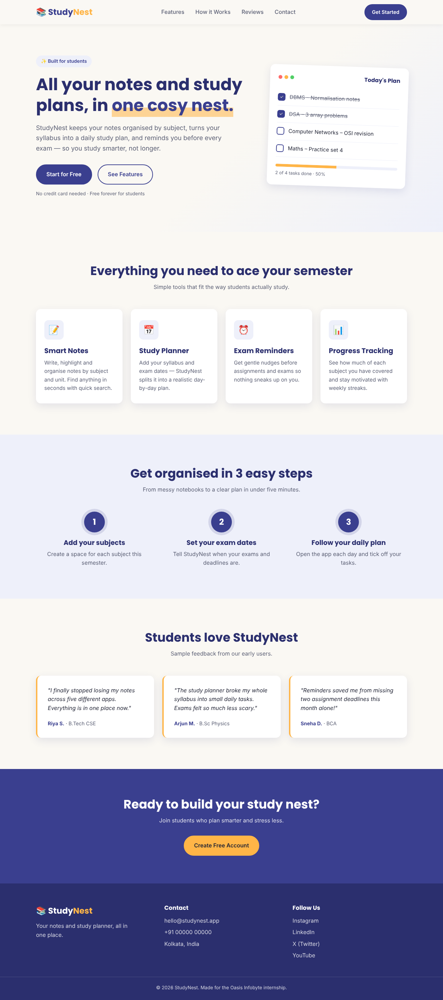
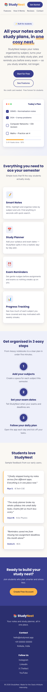

# 📚 StudyNest – Landing Page

**Oasis Infobyte Internship (OIBSIP) · Web Development & Designing · Level 1 · Task 1**

A responsive static landing page for **StudyNest**, a made-up notes and study-planner app for students. It is built with HTML5 and CSS3 only, with no JavaScript.

## 🔗 Live Demo
_Add your GitHub Pages link here_

## 🛠️ Tech Stack
- HTML5 (semantic tags: `nav`, `header`, `section`, `article`, `footer`)
- CSS3 (Flexbox, Grid, CSS variables, media queries)
- Google Fonts: Poppins (headings) and Inter (body)

## ✅ Task Checklist
| Requirement | Done |
|---|---|
| Sticky navigation bar with 3+ links | ✅ 4 links |
| Hero section: headline, subheadline, CTA button | ✅ |
| At least 2 content sections | ✅ Features, How it Works, Testimonials |
| Footer with contact and social links | ✅ |
| Consistent colour palette | ✅ CSS variables in `:root` |
| Responsive layout (Flexbox / Grid) | ✅ Breakpoints at 900px and 640px |
| No element overlap (`box-sizing` set) | ✅ |
| 2+ font sizes (heading vs body) | ✅ |

## 🎨 Colour Palette
| Role | Colour |
|---|---|
| Primary | `#3A3F8F` |
| Accent | `#FFB547` |
| Background | `#FAF8F3` |
| Text | `#1F2233` |

## 📸 Screenshots

## ▶️ Run Locally
Open `index.html` in a browser, or use the VS Code **Live Server** extension.

---
Made by **Arghanil Mukherjee** during the Oasis Infobyte Student Internship Program.