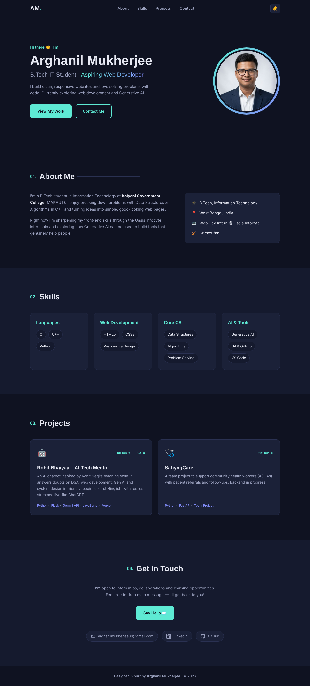
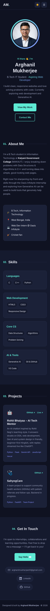

# 👨‍💻 Personal Portfolio – Arghanil Mukherjee

**Oasis Infobyte Internship (OIBSIP) · Web Development & Designing · Level 1 · Task 2**

My personal portfolio website. It shows my profile, skills and projects, and how to contact me. It works on desktop and mobile and has a light/dark theme toggle.

## 🔗 Live Demo
_https://github.com/arghanilmukherjee00-droid/OIBSIP/tree/main/WebDev-L1-Portfolio_

## 🛠️ Tech Stack
- HTML5 (semantic layout)
- CSS3 (Flexbox, Grid, CSS variables, media queries, smooth scroll)
- JavaScript (optional extras: theme toggle, mobile menu, active link highlight)
- Google Fonts: Space Grotesk and Inter

## ✅ Task Checklist
| Requirement | Done |
|---|---|
| Profile/hero: name, role title, avatar | ✅ |
| About Me section (2–3 sentences) | ✅ |
| Skills section as a visual grid | ✅ 4 skill groups |
| Projects section with 2+ cards (title, description, GitHub link) | ✅ 3 cards |
| Contact section: name, email, LinkedIn/GitHub icons | ✅ |
| Smooth scroll navigation | ✅ `scroll-behavior: smooth` |
| Consistent branding (colours, fonts) | ✅ CSS variables |
| Fully responsive | ✅ Breakpoints at 900px and 640px |

## ✨ Extra Features
- 🌗 Light/dark mode that remembers your choice
- 📱 Hamburger menu on mobile
- 🔦 Nav link highlights the section currently on screen

## 📸 Screenshots

## ▶️ Run Locally
Open `index.html` in a browser, or use the VS Code **Live Server** extension.

## 📬 Contact
- Email: arghanilmukherjee00@gmail.com
- LinkedIn: [arghanil-mukherjee](https://www.linkedin.com/in/arghanil-mukherjee-a4bbb936b/)
- GitHub: [arghanilmukherjee00-droid](https://github.com/arghanilmukherjee00-droid)