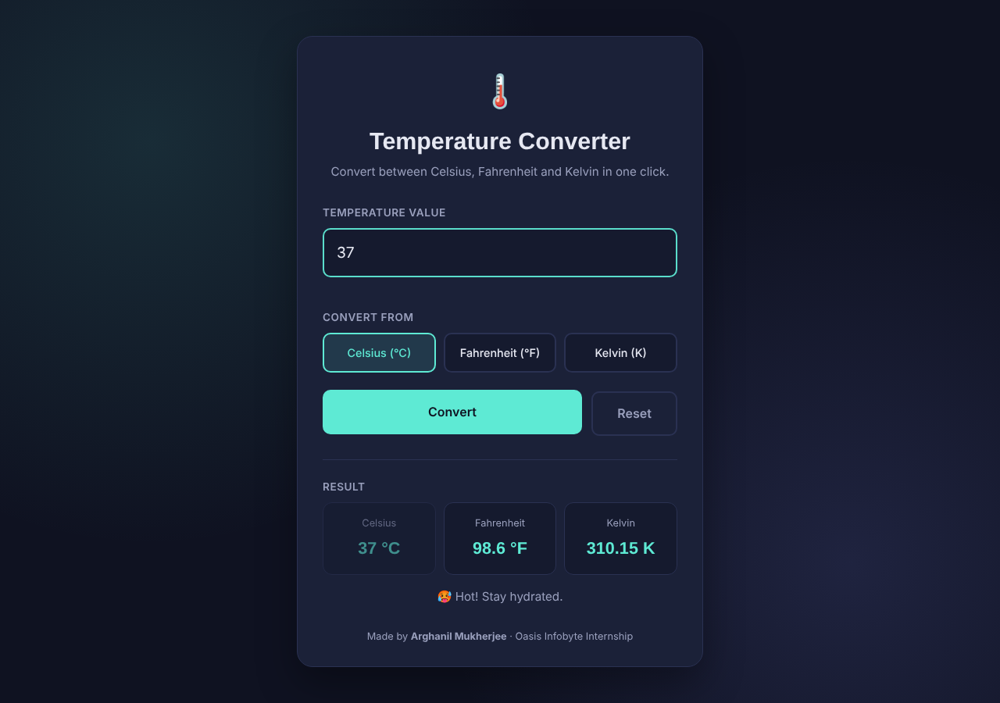
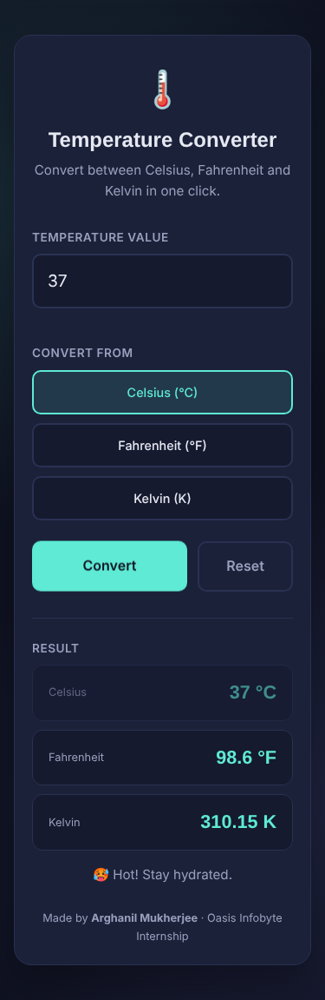

# 🌡️ Temperature Converter

**Oasis Infobyte Internship (OIBSIP) · Web Development & Designing · Level 1 · Task 3**

A simple web tool that converts a temperature between **Celsius, Fahrenheit and Kelvin**. It shows all three units at once and checks the input before converting.

## 🔗 Live Demo
_Add your GitHub Pages link here_

## 🛠️ Tech Stack
- HTML5
- CSS3 (Flexbox, Grid, media queries)
- Vanilla JavaScript (no libraries)

## ✅ Task Checklist
| Requirement | Done |
|---|---|
| Numeric input with an error message for non-numeric values | ✅ |
| Unit selector for the input unit (radio buttons) | ✅ Celsius / Fahrenheit / Kelvin |
| All output units shown at the same time | ✅ |
| Convert button that runs the calculation on click | ✅ (Enter key works too) |
| Result area with correct unit labels | ✅ |
| Friendly message for values below absolute zero | ✅ |
| Clean, centred layout with clear labels | ✅ |

## 🧮 Formulas Used
| Conversion | Formula |
|---|---|
| °C → °F | `F = C × 9/5 + 32` |
| °F → °C | `C = (F − 32) × 5/9` |
| °C → K | `K = C + 273.15` |
| K → °C | `C = K − 273.15` |

The app first converts every input to Celsius, then works out all three units from that Celsius value.

## ⚠️ Input Checks
- Empty input → "Please enter a temperature value."
- Letters or symbols (e.g. `abc`, `12a`) → "That's not a valid number."
- Below absolute zero (−273.15 °C / −459.67 °F / 0 K) → explains the limit

## 📸 Screenshots

## ▶️ Run Locally
Open `index.html` in a browser, or use the VS Code **Live Server** extension.

---
Made by **Arghanil Mukherjee** during the Oasis Infobyte Student Internship Program.